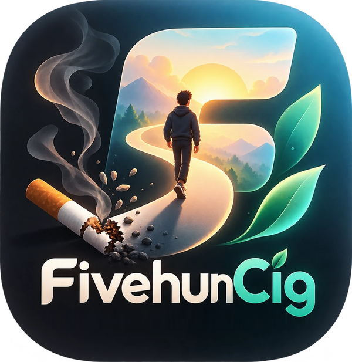

<div align="center">



# FivehunCig

### Not ready to quit? Start anyway.

A quit-smoking app that works in **one tap**, with no sign-up and **no shaming**.
Your data never leaves your phone.


**English · Français · العربية (right-to-left)**

</div>

---

## Why it exists

Most quit apps are built for people who have already set a quit date. Most smokers haven't.
And when a craving hits, a cigarette takes two seconds. If an app takes twenty, it loses.

FivehunCig is built around that moment:

> **Tap "I have a craving" and it starts right away.** No questions, no menus, no rating.
> Two minutes of guided breathing, one of *your own* reasons on screen, then **"I made it"** or **"I smoked"**. That's all.

---

## What's inside

| | |
|---|---|
| 🫁 **One-tap craving help** | Breathing starts the moment you tap: 4 seconds in, 4 hold, 6 out. Your reason (and its photo) stays on screen while the craving peaks. |
| ☁️ **Mahla, your guide** | A small breath-cloud who stays with you through every tool: "Halfway there. You're doing it." Never shaming, never preachy. |
| 🃏 **One card at a time** | Today fits on one screen. Mahla shows the single most useful thing right now: a check-in, your riskiest hour with your plan, your reason, or medicine help. |
| ⏱️ **Three paces** | *Just watch*, *Cut down slowly* (a Next Cigarette Timer whose wait grows a little each week) or *Quit now*. Switch any time. |
| 🔔 **Reminders that come to you** | One daily reminder at a time you choose, with a **"Breathe now"** button right on the notification. At most 2 notifications a day, mute with one tap. |
| 🔒 **Private on a shared phone** | Lock-screen text is neutral by default ("Mahla · Your daily reminder"). Showing your progress there is opt-in. |
| 💊 **The strongest help, from day one** | Medicine plus support is what works best. The app shows what to ask your pharmacist, in **your own numbers**, in English, French or Arabic, ready to show or share. No doses, ever: the pharmacist decides. |
| 🤝 **Slips are not failure** | One cigarette never erases your smoke-free days. Slip rescue asks what happened and helps you plan for next time. |
| 📈 **Progress that's honest** | Money kept, cigarettes skipped, cravings beaten, a health timeline. No fake numbers, no guilt. |
| 🆘 **Help when it's serious** | Verified support lines by country, a "feeling very low?" path, and a clear list of when to see a doctor. |

---

## Built on evidence, not hype

The design follows a research review in [`docs/RESEARCH_QUIT_EVIDENCE.md`](docs/RESEARCH_QUIT_EVIDENCE.md) (Cochrane reviews, WHO 2024 guideline, iCanQuit trial):

- **Medicine plus support** has the strongest evidence, so the app points to it early and often.
- **Cutting down first** can work as well as stopping all at once, so cut-down is a full mode, not a side option.
- **If-Then plans** ("if I have coffee, then I drink water first") help people follow through.
- **Short tools for cravings** (exercise, slow breathing) help in the moment.

> ⚠️ **Medical note.** FivehunCig supports you; it does not replace a doctor or pharmacist. The health text has **not yet been reviewed by a clinician** (see [`docs/CONTENT_REVIEW.md`](docs/CONTENT_REVIEW.md)). Anything about medicine is marked `CLINICIAN_REVIEW` in the code.

---

## Privacy by design

- ✅ **No account, no email, no ads, no analytics, no tracking.**
- ✅ Everything is stored **on the phone only**. Export or delete it all from Settings.
- ✅ 18+ and consent are confirmed in onboarding.
- ✅ The optional online features (an AI support chat and a peer community) are **switched off in release builds** until they have a budget and a moderator.

Full policy: [`docs/PRIVACY.md`](docs/PRIVACY.md).

---

## Accessibility

- Full **right-to-left** layout in Arabic, with numbers and mixed scripts handled correctly
- Works at **200% text size** and on narrow phones
- **Reduce motion** respected; contrast checked at **4.5:1** or better
- Tap targets of at least 44–48 px, screen-reader labels throughout

---

## Run it

**Requirements:** Node 20+ (22 recommended).

```bash
npm install
npx expo start
```

- **Quick UI check in the browser:** `npm run web`
- **On a phone:** scan the QR code with Expo Go. Note: Android Expo Go can't show notifications since SDK 53. Use a development build to test reminders:

```bash
npx eas-cli@latest build --profile development --platform android
```

### Feature switches

Some parts are kept in the code but hidden for the first test release ([`src/config/features.ts`](src/config/features.ts)):

| Switch | What it brings back | Default |
|---|---|---|
| `EXPO_PUBLIC_FEATURE_CHAT=1` | AI support chat (needs `ANTHROPIC_API_KEY`, see [`docs/AI_CHAT.md`](docs/AI_CHAT.md)) | on in development, off in release |
| `EXPO_PUBLIC_FEATURE_COMMUNITY=1` | Peer community (needs Supabase, see [`docs/COMMUNITY.md`](docs/COMMUNITY.md)) | on in development, off in release |
| `EXPO_PUBLIC_FEATURE_EXTRAS=1` | Puzzle games, guided imagery, weekly challenges | off |
| `EXPO_PUBLIC_FEATURE_LEARN=1` | The Learn library (19 articles, waiting for clinical review) | off |

Secrets go in `.env.local` (never committed). Copy [`.env.example`](.env.example) to start.

---

## Quality checks

```bash
npm run check
```

Runs everything: TypeScript (strict), ESLint, **208 unit tests** (Jest) and **20 database security tests** for the community backend.

---

## Project layout

```
src/
  app/          screens and routes (Expo Router)
  domain/       pure, tested logic: timer, stats, ratings, Today cards, reminders, safety
  components/   UI kit, Mahla guide, pharmacist script, craving check
  services/     notifications, sounds, actions that keep data and reminders in sync
  store/        app state on the phone (zustand + AsyncStorage, versioned migrations)
  i18n/         English, French and Arabic, with real plural rules
  config/       feature switches
docs/           architecture, research, privacy, content review, voice and video scripts
supabase/       optional community backend: migrations and security tests
```

**Stack:** Expo SDK 57 · React Native 0.86 · Expo Router · TypeScript · zustand · expo-notifications · expo-audio · Jest

---

## Roadmap

- [ ] Clinical and native-speaker review of all health text
- [ ] Mahla's voice, recorded ([`docs/VOICE_SCRIPT.md`](docs/VOICE_SCRIPT.md))
- [ ] Android test release (APK) and free app stores
- [ ] A "how to say no" line for when a friend offers you one
- [ ] Optional app lock for shared phones

---

<div align="center">

Made by a smoker who wants to quit, for everyone who isn't ready yet.
**One tap. One craving at a time.**

</div>
